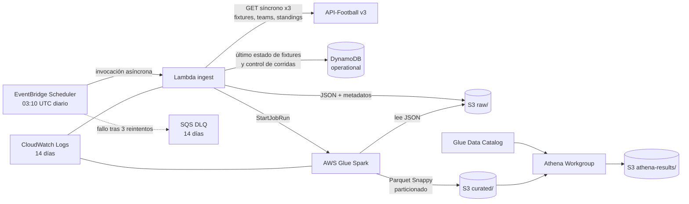

# Arquitectura de la solución

## Caso de uso

Construir un lago analítico de resultados de fútbol que permita comparar resultados, goles y tabla de posiciones de una liga. La implementación de referencia usa **Premier League (`league_id=39`) y temporada 2024**. En noviembre de 2026, API-Football indica que el plan gratuito cubre temporadas históricas 2022–2024; por eso 2024 es el valor predeterminado. Un plan que incluya la temporada actual solo requiere cambiar `season` en Terraform.

## Diagrama

## Flujo técnico

1. EventBridge Scheduler invoca Lambda una vez al día a las 03:10 UTC.
2. Lambda obtiene la clave desde SSM Parameter Store y realiza tres llamadas `GET` a API-Football: `/fixtures`, `/teams` y `/standings`.
3. Lambda valida tanto el código HTTP como el campo lógico `errors` del API. Primero descarga las tres respuestas y solo después escribe, para evitar una fotografía diaria incompleta.
4. Cada respuesta se guarda en `raw/` sin modificar, envuelta únicamente con metadatos de ejecución, URL, liga, temporada, fecha y cuota restante.
5. Lambda actualiza DynamoDB con la versión operacional más reciente de cada fixture y un registro de control de la corrida.
6. Lambda inicia el job de Glue. Spark lee solo los tres objetos de esa corrida, aplana las estructuras, elimina duplicados por llave de negocio y escribe Parquet/Snappy en `curated/`.
7. Athena consulta tres tablas externas del Glue Data Catalog. El workgroup obliga a escribir resultados en `athena-results/`, cifra los resultados y cancela consultas que intenten leer más de 100 MiB.

## Evento de ingesta: A–D

### A. Evento

Una **programación cron** dispara la llegada del dato: `cron(10 3 * * ? *)`, todos los días a las 03:10 UTC.

### B. Clasificación

El disparador es **asíncrono**: EventBridge Scheduler entrega el evento y no mantiene a una persona esperando. Dentro de Lambda, cada llamada HTTP al proveedor es síncrona porque la función necesita recibir y validar la respuesta antes de persistirla.

### C. Justificación cuantitativa

- Frecuencia: 1 corrida/día.
- Solicitudes: 3 solicitudes/día, frente a 100 solicitudes/día disponibles en el plan gratuito general de API-Sports.
- Volumen de diseño x1: aproximadamente 2 MB de JSON/día; x3: 6 MB/día.
- Respuesta esperada: menos de 25 segundos por endpoint; timeout total de Lambda: 120 segundos.
- Transformación esperada: 5 minutos x1 y 10 minutos x3 con 2 workers G.1X.
- RPO académico: 24 horas; RTO: 4 horas.

### D. Si falla la fuente

- Lambda reintenta errores de red, HTTP 429 y HTTP 5xx hasta tres veces con retroceso exponencial y *jitter*.
- Si la invocación completa falla, Scheduler reintenta tres veces durante un máximo de una hora.
- Si no puede entregar la invocación, el evento queda en SQS DLQ durante 14 días.
- El `run_id` diario es determinista; un reintento sobrescribe la misma fotografía en lugar de crear objetos pequeños duplicados.
- Glue solo se inicia después de guardar las tres entidades y actualizar DynamoDB. El job lee únicamente esos tres objetos; el histórico raw se usa para auditoría o reproceso explícito.

## Región, zonas y replicación

Se usa **`us-east-1`** para todos los servicios. S3, DynamoDB, Lambda, Glue y Athena son servicios regionales y administrados; S3 Standard almacena datos de forma redundante en múltiples zonas de disponibilidad. Mantener todo en una región evita transferencias interregionales y simplifica permisos.

No se configura replicación entre regiones porque la fuente es pública y regenerable, el RPO aceptado es 24 horas y el proyecto no procesa datos personales. Se revisaría esta decisión si el RTO baja de 4 horas, el RPO baja de 24 horas, existe una obligación regulatoria de residencia o el costo de perder una corrida supera el costo anual de replicación.

## Tres razones para usar nube frente a centro de datos propio

1. **Pago por uso y escala a cero.** Lambda, Athena y Scheduler no requieren servidores encendidos. En este proyecto Glue es prácticamente el único costo material.
2. **Servicios administrados integrados.** S3, Glue Data Catalog, Athena, IAM, CloudWatch y DynamoDB eliminan la instalación y operación de HDFS, Spark, un catálogo SQL y servidores de consulta.
3. **Elasticidad y trazabilidad.** El patrón puede repetirse por liga o ampliarse para agrupar varias ligas en la misma corrida; CloudTrail, logs y etiquetas ofrecen evidencia sin desplegar una plataforma de auditoría propia.

## Fuentes

- API-Football v3: https://api-sports.io/documentation/football/v3
- API-Sports planes y cuota: https://api-sports.io/
- Tutorial y temporadas del plan gratuito en 2026: https://www.api-football.com/news/post/how-to-get-all-data-from-a-league-with-api-football
- EventBridge Scheduler con Lambda: https://docs.aws.amazon.com/lambda/latest/dg/with-eventbridge-scheduler.html
- Arquitectura analítica serverless de referencia: https://docs.aws.amazon.com/pdfs/whitepapers/latest/aws-serverless-data-analytics-pipeline/aws-serverless-data-analytics-pipeline.pdf
